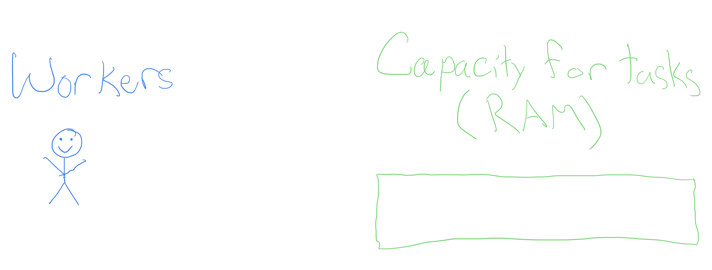
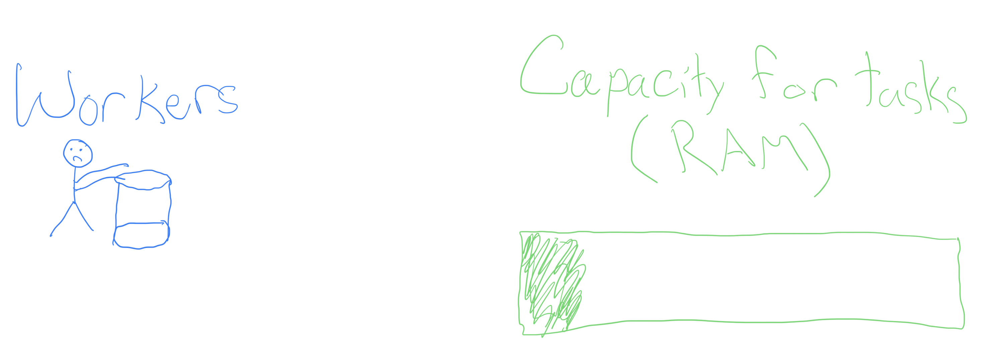
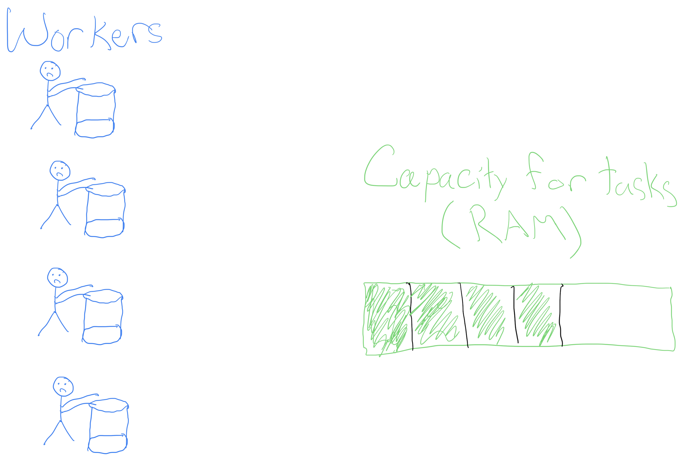

```{r}
#| include: false
#| warning: false
#| message: false

knitr::opts_chunk$set(echo = TRUE, warning = FALSE, message = FALSE,
                      fig.retina = 3, fig.align = 'center',
                      fig.asp = 0.75, fig.width = 8)
library(knitr)
library(tidyverse)
# 
# options(htmltools.preserve.raw = FALSE)
ggplot2::theme_update(text = ggplot2::element_text(size = 20))
```

::::: columns
::: {.column .center width="60%"}
{width="90%"}
:::

::: {.column .center width="40%"}
<br>

[Parallel Computing]{.custom-title}

<br> <br> <br> <br> <br>

[Grayson White]{.custom-subtitle}

[Stat 241 <br> Week 11 \| Fall 2026]{.custom-subtitle}
:::
:::::


------------------------------------------------------------------------


## Goals

:::: {.columns}


::: {.column .nonincremental}

**Last Time**: 

- Iteration
    - `for()` and `while()` loops
    - Functional programming

:::


::: {.column .fragment .nonincremental}

**Today**: 

- Parallel Computing
- Ethics

:::

::::


# Parallelism


------------------------------------------------------------------------

### Parallelism

- Last time, we learned how to **iterate** our code through `for()` loops and functional programming with `map_XXX()`.

- But sometimes, we'd like to iterate tasks that take a long time. 

- (Lots of iterations) + (Code that takes a long time to execute) = `r c(emo::ji("clock1"), emo::ji("clock2"), emo::ji("clock3"), emo::ji("clock4"), emo::ji("clock5"))`...


------------------------------------------------------------------------

### Parallelism

::: {.nonincremental}

- What if we could ask our computer to do some of those iterations at the same time as other iterations? 
    - **Example**: Instead of running 100 tasks that each take 1 minute sequentially (total: 100 minutes), do those same 100 tasks, but always be doing 4 at a time (total: 25 minutes)
    
:::

::: {.fragment}
    
```{r}
#| echo: false
#| out-width: '60%'

```

:::


------------------------------------------------------------------------

### Parallelism: Workers

- In order to think about parallel computing, we need to consider two components of your computer:

::: {.fragment}


{width='100%'}

:::


------------------------------------------------------------------------


### A task! 

::: {.nonincremental}

- Typically, we ask one worker to go do a task, e.g.,
    - Execute a particular R command, or

:::


{width='100%'}


------------------------------------------------------------------------


### A task! 

::: {.nonincremental}

- Typically, we ask one worker to go do a task, e.g.,
    - Execute a particular R command, or
    - churn 4 buckets of butter

:::


{width='100%'}


------------------------------------------------------------------------


### Churning butter, together

::: {.nonincremental}

- Churning butter is monotonous, but doesn't take one's full effort (see the RAM)

:::


{width='100%'}


------------------------------------------------------------------------


### Churning butter, together

::: {.nonincremental}

- What if, instead of waiting for the worker to finish the first bucket to go onto the next, we hired more workers? 

:::


{width='100%'}


------------------------------------------------------------------------


### Churning butter, together

::: {.nonincremental}

- What if, instead of waiting for the worker to finish the first bucket to go onto the next, we hired more workers? 

:::


{width='60%' fig-align='center'}


------------------------------------------------------------------------

### Churning butter, together

::: {.nonincremental}

- We get more butter faster! 

- **Not a free lunch**: have to pay the workers in RAM. 

:::


{width='60%' fig-align='center'}


------------------------------------------------------------------------


### Parallelized `for()` loops with `foreach` and `doParallel`

The `foreach` library provides functionality similar to `for()` loops, but with slightly different syntax

-   On it's own, it doesn't include parallel operations


::: {.fragment}

:::: {.columns}

::: {.column}

**Standard `for()` loop**

```{r}
vec <- rep(NA, 12)
for (i in 1:12) {
  vec[i] <- i * 10
}
vec
```

:::

::: {.column}

**Loop made with `foreach()`**

```{r}
library(foreach)
vec <- foreach(i = 1:12, .combine = 'c') %do% {
  i * 10
}
vec
```


:::

::::

:::


-   `.combine` tells `foreach()` how to combine the elements into `vec`. 
     - By default, we would get a `list()` back. 
     
-   Can set `.export` to load packages necessary for computation


------------------------------------------------------------------------

### Parallelized `for()` loops with `foreach` and `doParallel`

Combining functionality of `foreach` with `doParallel` let's us write loops in parallel! 

:::: {.columns}


::: {.column}

**Sequential**:

```{r}
#| cache: true
system.time({
  vec <- foreach(i = 1:12, .combine = 'c') %do% {
    Sys.sleep(1)  # Sleep for 1 second
    i * 10
  }
})

vec
```


:::


::: {.column .fragment}

**In parallel**:

```{r}
#| cache: true
library(doParallel)
detectCores(logical = FALSE) # my laptop has 12 cores
registerDoParallel(4) # Initialize 4 parallel processes

system.time({
  vec <- foreach(i = 1:12, .combine = 'c') %dopar% {
    Sys.sleep(1)  # sleep for 1 second
    i * 10
  }
})

stopImplicitCluster() # stop the parallel processes

vec
```

:::


::::

- The `system.time()` calls are just for illustrative purposes, and are uncessary for calling these loops. 


------------------------------------------------------------------------

### Parallelized `for()` loops with `foreach` and `doParallel`

:::: {.columns}


::: {.column}


Last time, we created a bootstrap distribution for the mean `DBH` for our sample of Portland trees:


```{r}
#| cache: true
pdxTrees <- pdxTrees::get_pdxTrees_parks()

boot <- tibble(avg = rep(NA, 100000))

system.time({
  for (i in 1:nrow(boot)) {
    boot[i, ] <- mean(sample(pdxTrees$DBH, replace = TRUE))
  }
})
```


:::

::: {.column .fragment}


Now, we can do this **in parallel**:


```{r}
#| cache: true
library(doRNG) # thread-safe RNG
pdxTrees <- pdxTrees::get_pdxTrees_parks()

registerDoParallel(10)

system.time({
  boot <- foreach(i = 1:100000, .combine = 'rbind') %dorng% {
    tibble(
      avg = mean(sample(pdxTrees$DBH, replace = TRUE))
    )
    
  }
})

stopImplicitCluster()
```

:::

::::


- Why only **~3 times faster** in parallel if we are using **10** workers??


# Parallelized `map_XXX()`ing with `furrr`

{width="20%"}

------------------------------------------------------------------------

### Parallelized `map_XXX()`ing with `furrr`


- The `furrr` packages enables functional programming in parallel, with syntax and functionality mimics `purrr`.


:::: {.columns}


::: {.column .fragment}

**Last time**: 

```{r}
#| cache: true
library(purrr)
boot_mean <- function(x) {
  mean(sample(x, replace = TRUE))
}

system.time({
  map_dbl(1:100000, ~ boot_mean(pdxTrees$DBH))
})
```

:::


::: {.column .fragment}


Now, **in parallel**:

```{r}
#| cache: true
library(furrr)
boot_mean <- function(x) {
  mean(sample(x, replace = TRUE))
}

future::plan(multisession, workers = 10)

system.time({
  future_map_dbl(1:100000, ~ boot_mean(pdxTrees$DBH), 
                 .options = furrr_options(seed = TRUE))
})
```

- `seed` option allows us to do thread-safe random number generation. 


:::


::::


------------------------------------------------------------------------

### Parallel computing: best practices and tips

- **Startup cost**: it is (time) costly to start up many R processes to do something that is a relatively fast computation.

- **Big data**: Try to limit your parallel computing to only include the necessary objects. Moving large objects across R sessions is (time) costly. 

- You must consider thread-safe random number generation.

- Parallel computing is a balance of **RAM**, **workers/cores**, and **costly operations** like moving big data around and worker startup cost. 

- An art and a science! Practice tends to make you better at balancing these things.


------------------------------------------------------------------------

### Next time

::: {.nonincremental}

- Discuss data ethics and LLMs.

:::


**On the horizon**: We'll learn to write our own `R` packages!


