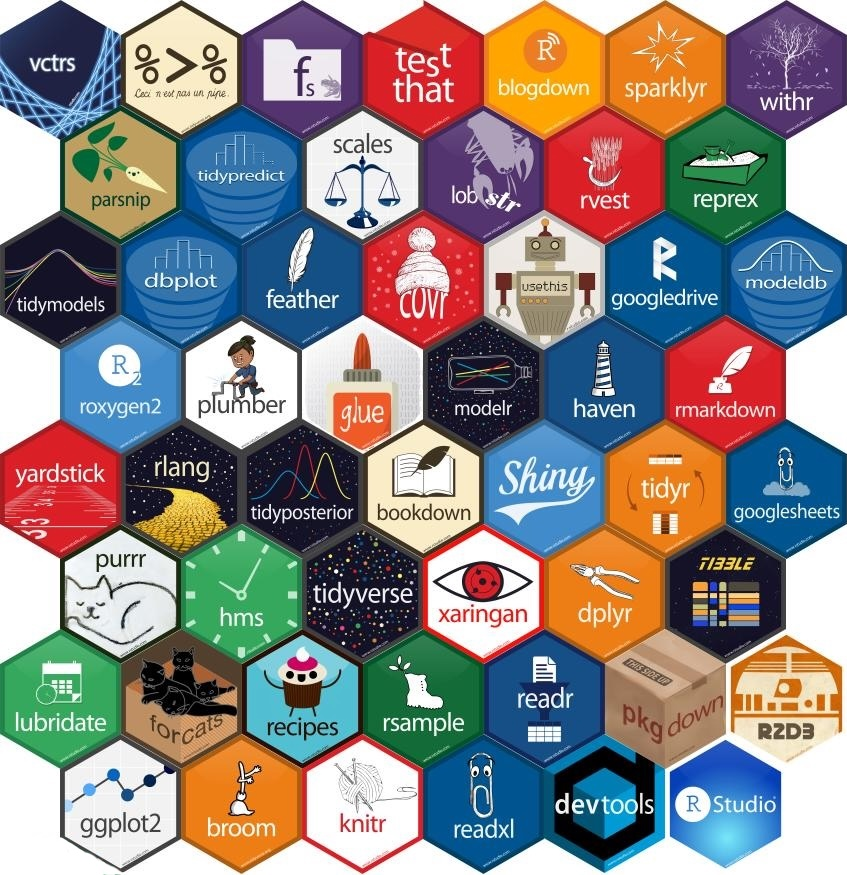
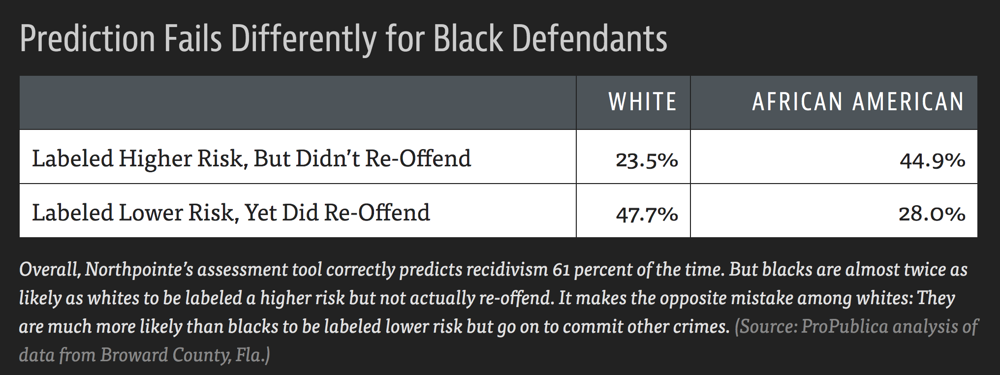
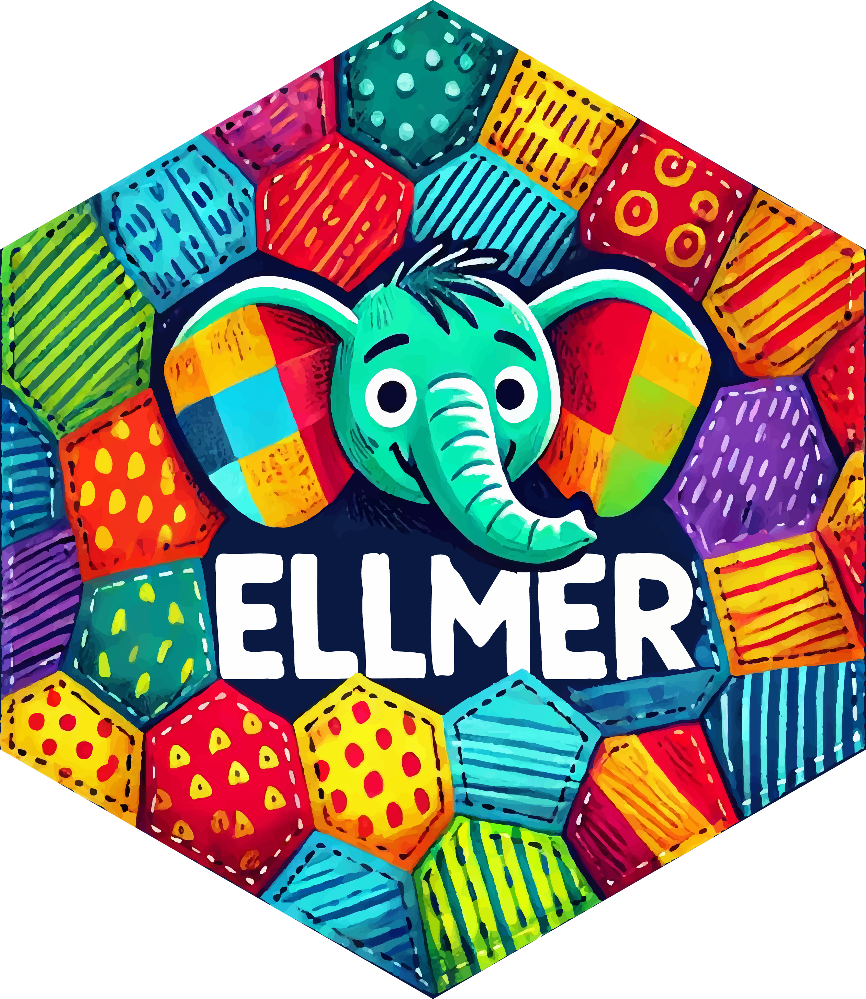
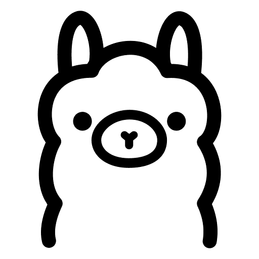
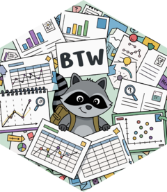
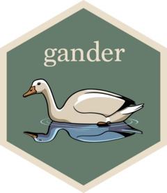
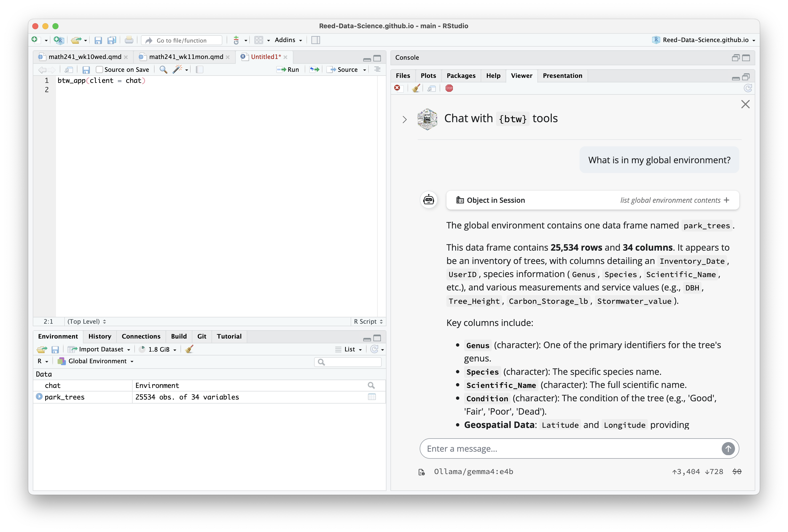

```{r}
#| include: false
#| warning: false
#| message: false

knitr::opts_chunk$set(echo = TRUE, warning = FALSE, message = FALSE,
                      fig.retina = 3, fig.align = 'center',
                      fig.asp = 0.75, fig.width = 8)
library(knitr)
library(tidyverse)
# 
# options(htmltools.preserve.raw = FALSE)
ggplot2::theme_update(text = ggplot2::element_text(size = 20))
```

::::: columns
::: {.column .center width="60%"}
{width="90%"}
:::

::: {.column .center width="40%"}
<br>

[Data Ethics and LLMs]{.custom-title}

<br> <br> <br> <br> <br>

[Grayson White]{.custom-subtitle}

[Stat 241 <br> Week 11 \| Fall 2026]{.custom-subtitle}
:::
:::::


------------------------------------------------------------------------

## Announcements

::: {.nonincremental}

* Fill out [this form](https://forms.gle/6FBbcMFmbSpyEeHM7) to help me create the Project 2 groups.
    + Groups and project instructions will be assigned on Monday.

:::


------------------------------------------------------------------------


## Week 11 Goals

:::: {.columns}


::: {.column .nonincremental}

**Monday Lecture**: 

- Practice with Local LLMs
- Extensions of `ellmer`

:::


::: {.column .fragment .nonincremental}

**Wednesday Lecture**: 

- Intro to writing `R` packages

:::

::::


# Data Ethics: Algorithmic Bias

[The Americian Statistical Association's ["Ethical Guidelines for Statistical Practice"](https://www.amstat.org/ASA/Your-Career/Ethical-Guidelines-for-Statistical-Practice.aspx)]{.custom-subtitle}

------------------------------------------------------------------------

## Integrity of Data and Methods

> "The ethical statistical practitioner seeks to understand and mitigate known or suspected limitations, defects, or biases in the data or methods and communicates potential impacts on the interpretation, conclusions, recommendations, decisions, or other results of statistical practices."

> "For models and algorithms designed to inform or implement decisions repeatedly, develops and/or implements plans to validate assumptions and assess performance over time, as needed. Considers criteria and mitigation plans for model or algorithm failure and retirement."

------------------------------------------------------------------------

### Algorithmic Bias

**Algorithmic bias**: when the model systematically creates unfair outcomes, such as privileging one group over another.

**Example**: [The Coded Gaze](https://www.youtube.com/watch?v=162VzSzzoPs)

```{r, echo = FALSE, out.width='35%', fig.cap = "Joy Buolamwini"}

```

-   Facial recognition software struggles to see faces of color.

-   Algorithms built on a non-diverse, biased dataset.

------------------------------------------------------------------------

### Algorithmic Bias

**Algorithmic bias**: when the model systematically creates unfair outcomes, such as privileging one group over another.

**Example**: [COMPAS model](https://www.propublica.org/article/machine-bias-risk-assessments-in-criminal-sentencing) used throughout the country to predict recidivism

::: nonincremental
-   Differences in predictions across race and gender
:::

```{r, echo = FALSE, out.width='45%', fig.cap = "ProPublica Analysis"}

```

-   Cynthia Rudin and collaborators wrote [The Age of Secrecy and Unfairness in Recidivism Prediction](https://hdsr.mitpress.mit.edu/pub/7z10o269/release/7)
    -   Argue for the need for transparency in models that make such important decisions.

------------------------------------------------------------------------

## Ethical considerations of using LLMs...


:::: .columns

::: {.column}

**Ethical considerations**:

- Algorithmic bias

- Fair use / copyright considerations

::: {.fragment .nonincremental}

- Environmental concerns:
    - Water
    - Electricity
    - Carbon emissions
    
:::
    
- Others?
    - One of my biggest worries: **learning** 

:::

::: {.column .fragment}

::: {.nonincremental}

**Helpful context**: our readings for today

- [Explained: Generative AI’s environmental impact](https://news.mit.edu/2025/explained-generative-ai-environmental-impact-0117)

- [A software engineer's "typical" electricity useage from LLMs](https://www.simonpcouch.com/blog/2026-01-20-cc-impact/)

- [Gruelling, low-paid human work behind generative AI curtain](https://www.ctvnews.ca/sci-tech/article/gruelling-low-paid-human-work-behind-generative-ai-curtain/)

:::

- Good for understanding environmental and human welfare concerns. **Algorithmic bias** and **fair use** on the other hand...


:::


::::


# Discussion time

------------------------------------------------------------------------

## Ethical considerations of using LLMs...


::: {.blockquote}

*Data Science* is a uniquely **humanistic** field situated behind a laptop. We have responsibility to understand and mitigate **algorithmic bias** by asking questions such as:

:::

<br>

- Who are represented in the sample?

- Who are **not** represented in the sample?

- What biases might my methods (including generative AI!) introduce?

- How can I safeguard against those biases?


------------------------------------------------------------------------


## Ethical considerations of using LLMs...


::: {.blockquote}

Generative AI tools are being used in horrific and unethical ways as we speak (e.g., [Flock cameras](https://www.youtube.com/watch?v=Pp9MwZkHiMQ)). Not to mentioned they are trained on people's intellectual content without their consent.

:::

<br>


::: {.fragment}

**My goals**:

- Teach how to use generative AI as an ethical data scientist
    - Consider productive (and unproductive) use-cases for this technology

- Help you be **informed** on the current state of generative AI and large language models
    - Only informed people can help change policy.


:::


# What is a large language model? `r emo::ji("thinking")`

------------------------------------------------------------------------


## What is a large language model?

- A large language model (LLM) is a **predictive model** designed to predict the next token of text, conditional on the given context.

- Just like any statistical model, one must **train** the model and you can use the model to **make new predictions**
    - Think: Linear regression. You **fit / train** your linear regression model to obtain $\hat{\beta}$'s that you can make new predictions with.

- Companies like OpenAI, Anthropic, and Google host trained models on their servers, and charge users to use them.

- Why can't you run these locally?
    - You can! But only smaller models...
    - Trained LLMs are **large**. The "weight matrices" associated with a given training output take extremely large amounts of computing power to use.
    - Need enough RAM + computing power to do matrix multiplication on these weight matrices.

------------------------------------------------------------------------


## Local vs. cloud-based LLMs


:::: {.columns}


::: {.column}

**Local LLMs**:

::: {.fragment .nonincremental}

- Smaller.
    - Generally, 1GB RAM = 1 billion model parameters
:::

::: {.fragment .nonincremental}

- More secure.
    - You are not sending your data off to someone else's server.

:::

::: {.fragment .nonincremental}

- "Open" weights.
    - You host the weights matrix.
    - All computing happens on your machine.

:::

::: {.fragment .nonincremental}

- Requires decent computing power.

:::

:::

::: {.column .fragment}

**Cloud-based LLMs**:


::: {.nonincremental}

- Big!
    - Generally: larger model --> better predictions

:::


::: {.fragment .nonincremental}

- Less secure.
    - If it is free, **you** are the product.

:::


::: {.fragment .nonincremental}

- Often closed-weights.
    - Computing happens at a data center.

:::


::: {.fragment .nonincremental}

- Can use these on anything that can access the internet.

:::


:::

::::


<!-- ------------------------------------------------------------------------ -->

<!-- ## Local vs. cloud-based LLMs -->

<!-- - For our purposes, we will use a cloud-based LLM. -->

<!-- - I encourage you to explore what can be done with local LLM's if it interests you. -->
<!--     - Start with: [Ollama](https://ollama.com/) -->


# LLMs from a Data Scientist's Perspective


{fig-align='center' width='20%'}

------------------------------------------------------------------------

## `ellmer`

An `R` package for interacting with LLMs in `R`

{.absolute height="250px" right="0" top="0" fig-alt="The ellmer hex sticker, a colorful elephant in a patchwork of fabrics."}

<br> <br> <br>

::: {.fragment}

Today, we'll explore `ellmer` to do three different types of tasks one may want to with an LLM:

:::


1. Structured data

2. Tool calling

3. Coding


<!-- ## `ellmer`: Setup -->

<!-- In order to interact with LLMs hosted on a server, we need to first set up an API key. -->

<!-- - [Cerebras](https://www.cerebras.ai/) provides "free" access to some LLMs they host, but you still need to get an API key. -->
<!--     - This "free" access has **rate limits** -->


<!-- ::: {.fragment} -->

<!-- **Steps**: -->

<!-- 1. Go to [https://www.cerebras.ai/](https://www.cerebras.ai/) and click "Get Started" to create an account. -->

<!-- ::: -->

<!-- ::: {.fragment .nonincremental} -->

<!-- 2. Once your account is created, find your API key and set it in your `R` environment: -->

<!-- ```{r} -->
<!-- #| eval: false -->
<!-- # This will open a file called .Renviron -->
<!-- usethis::edit_r_environ() -->
<!-- ``` -->

<!-- Then add: -->

<!-- `OPENAI_API_KEY=INSERT_YOUR_KEY_HERE` -->

<!-- to your .Renviron file. Save it. -->


<!-- ::: -->

<!-- 3. Restart R. -->

<!-- ------------------------------------------------------------------------ -->


## `ellmer`: Setup

In order to interact with LLMs hosted on a server (such as what I'll show today), it takes some setup that is covered on the internet, but I won't go over today.

------------------------------------------------------------------------


## `ellmer`: basics

```{r}
#| eval: false
library(ellmer)

chat <- chat_openai_compatible(
  base_url = "https://api.cerebras.ai/v1",
  model    = "qwen-3-235b-a22b-instruct-2507"
)

chat$chat("Who are you?")
#> Hello! I'm Qwen, a large-scale language model independently developed by the
#> Tongyi Lab under Alibaba Group. I can assist you with answering questions,
#> writing, logical reasoning, programming, and more. I aim to provide helpful and
#> accurate information. Feel free to let me know if you have any questions or need
#> assistance!
```

{.absolute height="250px" right="0" top="0" fig-alt="The ellmer hex sticker, a colorful elephant in a patchwork of fabrics."}

<!-- ::: {.fragment .nonincremental} -->

<!-- - "qwen-3-235b-a22b-instruct-2507" has the following rate limits: -->
<!--     - up to 30 requests per minute, -->
<!--     - 900 requests per hour, and -->
<!--     - 14,400 requests per day. -->

<!-- ::: -->

------------------------------------------------------------------------

## `ellmer`: Structured data

How would you extract name and age from this data?

```{r}
#| eval: false
prompts <- list(
  "I go by Alex. 42 years on this planet and counting.",
  "Pleased to meet you! I'm Jamal, age 27.",
  "They call me Li Wei. Nineteen years young.",
  "Fatima here. Just celebrated my 35th birthday last week.",
  "The name's Robert - 51 years old and proud of it.",
  "Kwame here - just hit the big 5-0 this year."
)
```

- Regular expressions?

------------------------------------------------------------------------

## `ellmer`: Structured data

LLMs are generally good at this sort of task

```{r}
#| eval: false
chat <- chat_openai_compatible(
  base_url = "https://api.cerebras.ai/v1",
  model    = "qwen-3-235b-a22b-instruct-2507",
)
chat$chat("Extract the name and age from each sentence I give you")
chat$chat(prompts[[1]])
#> **Name: Alex, Age: 42**
chat$chat(prompts[[2]])
#> **Name: Jamal, Age: 27**
chat$chat(prompts[[3]])
#> **Name: Li Wei, Age: 19**
```

------------------------------------------------------------------------

## `ellmer`: Structured data

But wouldn't it be nice to get an R data structure?

```{r}
#| eval: false
chat$chat(prompts[[3]])

# Want this:
#> list(
#>   name = "Li Wei",
#>   age = 19
#> )

# Instead of:
#> **Name: Li Wei, Age: 19**
```

<br>


::: {.fragment}

`ellmer` let's us do this with `chat_structured()`!

```{r}
#| eval: false
type_person <- type_object(
  name = type_string(),
  age = type_number()
)

chat$chat_structured(prompts[[1]], type = type_person)
#> List of 2
#>  $ name: chr "Alex"
#>  $ age : int 42
```

:::

------------------------------------------------------------------------

## `ellmer`: Structured data

`parallel_chat_structured()`: many prompts at once

```{r}
#| eval: false
chat <- chat_openai_compatible(
  base_url = "https://api.cerebras.ai/v1",
  model    = "qwen-3-235b-a22b-instruct-2507",
  params   = params(max_tokens = 500)
)
parallel_chat_structured(chat, prompts, type = type_person, rpm = 30)
#>     name age
#> 1   Alex  42
#> 2  Jamal  27
#> 3 Li Wei  19
#> 4 Fatima  35
#> 5 Robert  51
#> 6  Kwame  50
```

- Not parallel in the sense of parallelized R code: just sending many API calls at once.

- Have to set `params` in order to avoid getting rate-limited automatically.

------------------------------------------------------------------------

## `ellmer`: Structured data

Can also send attach images or other files by pointing to their directory on your computer.

```{r}
#| eval: false
paths <- dir("animals", full.names = TRUE)
images <- map(paths, ~ list(content_image_file(.x)))

type_animal_photo <- type_object(
  animal = type_string(),
  background_colour = type_string()
)

parallel_chat_structured(chat, images, type = type_animal_photo)
```


------------------------------------------------------------------------


## `ellmer`: Tool calling

<!-- LLMs don't have access to live data about the world -->

```{r}
#| eval: false
chat <- chat_openai_compatible(
  base_url = "https://api.cerebras.ai/v1",
  model    = "qwen-3-235b-a22b-instruct-2507"
)

chat$chat("What day is it?")
#> I don't have access to real-time information, so I can't tell you today's
#> date. You can check the current date on your device's calendar or by
#> asking a voice assistant like Siri, Google Assistant, or Alexa.
```

------------------------------------------------------------------------

## `ellmer`: Tool calling


```{r}
#| eval: false
today <- tool(
  function() Sys.Date(),
  name = "today",
  description = "Get the current date",
  arguments = list()
)
chat$register_tool(today)
```

------------------------------------------------------------------------

## `ellmer`: Tool calling

<!-- Now the model can know what day it is -->

```{r}
#| eval: false
chat$chat("What day is it today?")
#> ◯ [tool call] today()
#> ● #> "2026-04-05"
#> Today is Sunday, April 5, 2026.
```


# Coding (agents)

## Coding agent = LLM calling tools in a loop

...usually giving models the ability to read and write state

------------------------------------------------------------------------

## Coding agents

```{r}
#| eval: false
chat <- chat_openai_compatible(
  base_url = "https://api.cerebras.ai/v1",
  model    = "qwen-3-235b-a22b-instruct-2507"
)
chat$chat("Delete the csv files in my working directory")
#> I **cannot** delete files from your computer or working directory. I don't have
#> access to your file system for security reasons.
#>
#> However, here are safe ways you can delete CSV files in your working directory
#> depending on your environment:
#>
#> ### Option 1: Using Python
#> If you're using Python and want to delete all `.csv` files in the current
#> directory:
#> ...
```

------------------------------------------------------------------------

## Coding agents

```{r}
#| eval: false
chat <- chat_openai_compatible(
  base_url = "https://api.cerebras.ai/v1",
  model    = "qwen-3-235b-a22b-instruct-2507"
)
chat$chat("Delete the csv files in my working directory")
#> To delete all CSV files in your current working directory, you can use one of the
#> following methods depending on your operating system:
#>
#> ### **Method 1: Using Command Line / Terminal**
#>
#> #### **On Windows (Command Prompt):**
#> ```cmd
#> del *.csv
#> ```
#>
#> #### **On macOS or Linux (Terminal):**
#> ```bash
#> rm *.csv
#> ```
#>
#> > ⚠️ **Warning**: This permanently deletes all `.csv` files in the current
#> directory. Make sure you don’t need any of them!

```

Needs to be able to:

* Find files (read state)
* Delete files (write state)

------------------------------------------------------------------------

## Coding agents

The LLM needs to be able to **read** our working directory:

```{r}
#| eval: false
chat$register_tool(tool(
  function() dir(),
  name = "ls",
  description = "Lists the files in the current directory"
))
```


<br>

::: {.fragment}

And be able to remove files:

```{r}
#| eval: false
chat$register_tool(tool(
  function(path) unlink(path),
  name = "rm",
  description = "Delete one or more files",
  arguments = list(
    path = type_array(type_string())
  )
))
```

:::


------------------------------------------------------------------------

## Coding agents

Create some dummy `.csv` files

```{r}
file.create(c("a.csv", "a_please_dont_delete_me.csv", "b.csv"))
dir()
```

------------------------------------------------------------------------

## Coding agents

Now ask it to delete csv's that

```{r}
#| eval: false
chat$chat("Delete all the csv files in the current directory, unless they ask to not be deleted.")
#> ◯ [tool call] ls()
#> ● #> a_please_dont_delete_me.csv
#>   #> a.csv
#>   #> b.csv
#>   #> custom.scss
#>   #> data
#>   #> …
#> ◯ [tool call] rm(path = c("a.csv", "b.csv"))
#> ● #> 0
#> The CSV files `a.csv` and `b.csv` have been deleted.
#>
#> The file `a_please_dont_delete_me.csv` was not deleted, as it appears to be a
#> file you wish to keep based on its name.
#>
#> Let me know if you'd like to keep or remove any other files!
```

```{r}
#| echo: false
unlink("a.csv")
unlink("b.csv")
```

<br>

::: {.fragment}

```{r}
dir()
```

:::


<!-- # Local LLMs -->


<!-- ------------------------------------------------------------------------ -->

<!-- ## Local LLMs -->

<!-- - Last time, we discussed the **ethics** of LLMs and showed some examples of using LLMs for data science. -->

<!-- - We considered **local** vs **cloud-based** implementations of LLMs -->

<!-- :::: {.columns} -->

<!-- ::: {.column .fragment .nonincremental} -->

<!-- - Local LLMs have a lot of **advantages**: -->
<!--     - More secure -->
<!--     - Smaller and less power intensive (not sending compute requests to data centers) -->
<!--     - No rate limits -->

<!-- ::: -->

<!-- ::: {.column .fragment .nonincremental} -->

<!-- - ...But they also have their **disadvantages**: -->
<!--     - Can take longer to run depending on your hardware -->
<!--     - Not as "good" as larger models -->

<!-- ::: -->

<!-- :::: -->


<!-- - Today, we'll explore the data science use-cases of local LLMs. -->
<!--     - and use them to power `ellmer` and `ellmer` extensions! -->

<!-- ------------------------------------------------------------------------ -->

<!-- ## Ollama -->

<!-- :::: {.columns} -->

<!-- ::: {.column width='40%'} -->

<!--  -->

<!-- ::: -->

<!-- ::: {.column width='10%'} -->

<!-- ::: -->

<!-- ::: {.column width='50%'} -->


<!-- - [Ollama](https://ollama.com/) is the primary host of open-weights models -->

<!-- - You can download these models, and then connect them to `ellmer` with `chat_ollama()` -->

<!-- - You can also access cloud-based models through `ollama`, but these get rate-limited.  -->

<!-- ::: -->

<!-- :::: -->

<!-- - Now, let's talk about how to **install** Ollama and local models with it.  -->


<!-- ------------------------------------------------------------------------ -->

<!-- ## System check  -->

<!-- - In order to know what sorts of models your computer can handle, you'll need to look see **how much RAM** your computer has. -->

<!-- ::: {.fragment .nonincremental} -->

<!-- - Check RAM: -->

<!-- ```{r} -->
<!-- # install.packages("memuse") -->
<!-- memuse::Sys.meminfo() -->
<!-- ``` -->

<!-- ::: -->


<!-- - 24gb RAM --> (approximately up to) 24 billion parameter model -->
<!--     - "24 billion parameters" is often abbreviated with 24B.  -->
<!--     - Not always best to run the biggest model your computer can handle: will slow down other processes (and often be slow itself!) -->

<!-- - As long as you have 8gb+ you will be okay for today! 16gb+ is ideal.  -->

<!-- ------------------------------------------------------------------------ -->

<!-- ## Install Ollama -->

<!-- - Ollama is the **service** that allows us to easily download models -->
<!--     - **Installing Ollama** is analogous to **installing `git`**,  -->
<!--     - The **Ollama website** is analogous to **GitHub.com**, and -->
<!--     - The **models** are hosted just like **repos** are hosted on GitHub.com.  -->

<!-- ::: {.fragment .nonincremental}     -->

<!-- - To install Ollama, paste this in your terminal: -->

<!-- ``` -->
<!-- curl -fsSL https://ollama.com/install.sh | sh -->
<!-- ``` -->

<!-- ::: -->

<!-- <br> -->

<!-- ::: {.fragment} -->

<!-- After installation, if you run -->

<!-- ``` -->
<!-- which ollama -->
<!-- ``` -->

<!-- in your terminal, you should see something like: -->

<!-- ``` -->
<!-- /usr/local/bin/ollama -->
<!-- ``` -->

<!-- ::: -->


<!-- # Install our first local model -->

<!-- Let's navigate to [ollama.com](https://ollama.com/) and install a model. -->

<!-- ::: {.fragment} -->

<!-- <br> -->

<!-- Install models by running the following in your terminal: -->


<!-- `ollama pull {model_name}` -->


<!-- e.g., -->


<!-- `ollama pull gemma4:e4b` -->


<!-- ::: -->


<!-- ------------------------------------------------------------------------ -->

<!-- ## Connect local models with `ellmer` -->

<!-- ```{r} -->
<!-- library(ellmer) -->
<!-- chat <- chat_ollama(model = "gemma4:e4b") -->
<!-- ``` -->


<!-- ------------------------------------------------------------------------ -->


<!-- ## Connect local models with `ellmer` -->


<!-- **Your turn**: -->

<!-- Complete the task from last time: parse names and ages (but now with a local LLM of your choice) -->

<!-- ```{r ellmer1} -->
<!-- #| cache: true -->
<!-- #| output-location: column-fragment -->
<!-- type_person <- type_object( -->
<!--   name = type_string(), -->
<!--   age = type_number() -->
<!-- ) -->

<!-- prompts <- list( -->
<!--   "I go by Alex. 42 years on this planet and counting.", -->
<!--   "Pleased to meet you! I'm Jamal, age 27.", -->
<!--   "They call me Li Wei. Nineteen years young.", -->
<!--   "Fatima here. Just celebrated my 35th birthday last week.", -->
<!--   "The name's Robert - 51 years old and proud of it.", -->
<!--   "Kwame here - just hit the big 5-0 this year." -->
<!-- ) -->

<!-- parallel_chat_structured( -->
<!--   chat, -->
<!--   prompts, -->
<!--   type = type_person -->
<!-- ) -->

<!-- ``` -->

<!-- - Sometimes, really small models (like `gemma4:e4b`) really are sub-par... -->


<!-- ```{r} -->
<!-- #| echo: false -->
<!-- countdown::countdown(10) -->
<!-- ``` -->


<!-- ------------------------------------------------------------------------ -->

<!-- ## The `system.time({})` factor... -->

<!-- On my M4 Pro Macbook Pro with 24GB RAM,  -->

<!-- ```{r} -->
<!-- chat_local <- chat_ollama(model = "gemma4:e4b") -->
<!-- ``` -->


<!-- ```{r systime1} -->
<!-- #| cache: true -->
<!-- system.time({ -->
<!--   parallel_chat_structured( -->
<!--   chat_local, -->
<!--   prompts, -->
<!--   type = type_person -->
<!-- ) -->
<!-- }) -->
<!-- ``` -->

<!-- <br> -->

<!-- - When not rate-limited, this request on a **cloud-based** LLM should only take ~1 second.  -->


<!-- ------------------------------------------------------------------------ -->

<!-- ## Review -->

<!-- - Now, we can chat with **cloud-based** and **local** LLMs in `R` via `ellmer` -->

<!-- - We can even structure the type of data we'd like to get back!  -->

<!-- - And create tools, which let the LLMs perform specific tasks related to our computer or `R` session. -->

<!-- - To make this even more powerful: need to give the LLMs more **context** about our `R` environment.  -->
<!--     - Ideas?  -->
<!--     - We could write a **bunch** of a tools... -->
<!--     - Or... -->


<!-- # `ellmer` Extensions -->

<!-- ------------------------------------------------------------------------ -->

<!-- ## `ellmer` Extensions -->

<!-- - A team at Posit has been working to make interesting `R` packages that allow you to interact with LLMs in `R` -->

<!-- - Today, we'll explore a couple of these `R` packages -->

<!-- :::: {.columns .fragment} -->

<!-- ::: {.column} -->

<!-- {fig-align='center'} -->


<!-- ::: -->

<!-- ::: {.column} -->


<!-- {fig-align='center'} -->

<!-- ::: -->

<!-- :::: -->


<!-- ------------------------------------------------------------------------ -->


<!-- ## `btw`: Provide **context** to LLMs -->

<!-- {.absolute height="250px" right="0" top="0"} -->
<!-- <br> -->

<!-- <br> -->

<!-- <br> -->


<!-- - `btw` provides context about your `R` environment to LLMs through a variety of mediums:  -->
<!--     - Quickly copy context to your computer's clipboard, -->
<!--     - Through an interactive chat in your IDE, and -->
<!--     - In `ellmer` or `ellmer`-like chats. -->


<!-- ------------------------------------------------------------------------ -->

<!-- ## `btw`: copy-paste context -->


<!-- Provide **context for a data.frame**: -->

<!-- ```{r} -->
<!-- park_trees <- pdxTrees::get_pdxTrees_parks() -->

<!-- # install.packagaes("btw") -->
<!-- library(btw) -->


<!-- btw(park_trees) -->
<!-- #> ✔ btw copied to the clipboard! -->
<!-- ``` -->


<!-- <br> -->

<!-- ::: {.fragment} -->


<!-- Provide context for a data.frame, **and documentation**: -->

<!-- ```{r} -->
<!-- btw(park_trees, ?pdxTrees::get_pdxTrees_parks) -->
<!-- #> ✔ btw copied to the clipboard! -->
<!-- ``` -->

<!-- ::: -->


<!-- <br> -->


<!-- ::: {.fragment} -->

<!-- Even provide the **question** you'd like to ask. -->


<!-- ```{r} -->
<!-- btw(park_trees, ?pdxTrees::get_pdxTrees_parks, "What does the Crown_Width_NS variable measure? And in what units?") -->
<!-- #> ✔ btw copied to the clipboard! -->
<!-- ``` -->


<!-- ::: -->


<!-- ------------------------------------------------------------------------ -->

<!-- ## Pass context to `ellmer` chats with `btw` -->


<!-- ```{r btw1} -->
<!-- #| cache: true -->
<!-- chat <- chat_ollama(model = "gemma4:e4b") -->

<!-- chat$chat( -->
<!--   btw(park_trees,  -->
<!--       ?pdxTrees::get_pdxTrees_parks,  -->
<!--       "What does the Crown_Width_NS variable measure? And in what units?") -->
<!-- ) -->
<!-- ``` -->


<!-- - Passing the direct context you'd like to reference can be really helpful for getting quick responses from local LLMs, -->

<!-- - But if want `btw` to automatically find your context... -->


<!-- ------------------------------------------------------------------------ -->

<!-- ## Provide context in `ellmer` with `btw` -->


<!-- ```{r} -->
<!-- #| eval: false -->
<!-- chat <- chat_ollama(model = "gemma4:e4b") -->

<!-- chat$register_tools( -->
<!--   btw_tools("env") -->
<!--   # alternatively, call: -->
<!--   # btw_tools() -->
<!--   # to allow btw to use all of its built-in tools -->
<!-- ) -->

<!-- chat$chat("What is in my global environment?") -->
<!-- #> ◯ [tool call] btw_tool_env_describe_environment(`_intent` = "list global environment -->
<!-- #> contents") -->
<!-- #> ● #> ## Context -->
<!-- #>   #> -->
<!-- #>   #> -->
<!-- #>   #> park_trees -->
<!-- #>   #> ```json -->
<!-- #>   #> … -->
<!-- #> The global environment contains one data frame named `park_trees`. -->
<!-- #>  -->
<!-- #> This data frame contains **25,534 rows** and **34 columns**. It appears to be an inventory of -->
<!-- #> ... -->
<!-- ``` -->

<!-- - Providing a tool group (in this case: "env") stops the local model from getting overwhelmed by too much context. -->

<!-- - Let's take a look at the documentation for `btw_tools()`. -->


<!-- ------------------------------------------------------------------------ -->

<!-- ### There's also an interactive IDE chat -->

<!-- ```{r} -->
<!-- #| eval: false -->
<!-- chat <- chat_google_gemini() -->
<!-- btw_app(client = chat) -->
<!-- ``` -->

<!-- ::: {.fragment} -->

<!-- {fig-align='center' width='80%'} -->

<!-- ::: -->


<!-- ------------------------------------------------------------------------ -->


<!-- ## `gander` -->

<!-- {.absolute height="250px" right="0" top="0"} -->

<!-- - ...also provides **context** to LLMs in `R` -->

<!-- <br> <br>  -->

<!-- ::: {.fragment} -->

<!-- > gander is a higher-performance and lower-friction chat experience for data scientists in RStudio and Positron–sort of like completions with Copilot, but it knows how to talk to the objects in your R environment.  -->

<!-- ::: -->


<!-- ::: {.fragment} -->

<!-- > The package brings ellmer chats into your project sessions, automatically incorporating relevant context and streaming their responses directly into your documents. -->

<!-- ::: -->


<!-- - Let's take a look! -->


<!-- ------------------------------------------------------------------------ -->

<!-- ## Installing `gander` -->

<!-- ```{r} -->
<!-- #| eval: false -->
<!-- # first, install `gander`: -->
<!-- install.packages("gander") -->
<!-- ``` -->


<!-- ::: {.fragment .nonincremental} -->

<!-- Next, pick a model to power `gander`: -->


<!-- (a): for your **current `R` session**, -->

<!-- ```{r} -->
<!-- options(gander.chat = ellmer::chat_ollama(model = "gemma4:e4b")) -->
<!-- ``` -->

<!-- <br> -->

<!-- or (b): as your **default for all `R` session**: -->

<!-- ```{r} -->
<!-- #| eval: false -->
<!-- usethis::edit_r_profile() -->
<!-- # and then paste:  -->
<!-- # options(gander.chat = ellmer::chat_ollama(model = "gemma4:e4b")) -->
<!-- # into the loaded file. Restart R for this to take effect. -->
<!-- ``` -->


<!-- ::: -->

<!-- ------------------------------------------------------------------------ -->

<!-- ## Installing `gander` -->


<!-- ::: {.nonincremental} -->

<!-- Finally, set up a shortcut to `gander`: -->

<!-- (a): **In RStudio**, navigate to `Tools > Modify Keyboard Shortcuts > Search "gander"`. The package authors suggest `Ctrl+Alt+G` (or `Ctrl+Cmd+G` on macOS), or  -->

<!-- <br> -->

<!-- (b): **In Positron**, you'll need to open the command palette, run "Open Keyboard Shortcuts (JSON)", and paste the following into your `keybindings.json`: -->

<!-- ``` -->
<!--     { -->
<!--         "key": "Ctrl+Cmd+G", -->
<!--         "command": "workbench.action.executeCode.console", -->
<!--         "when": "editorTextFocus", -->
<!--         "args": { -->
<!--             "langId": "r", -->
<!--             "code": "gander::gander_addin()", -->
<!--             "focus": true -->
<!--         } -->
<!--     } -->
<!-- ``` -->


<!-- ::: -->


<!-- # `gander` demo -->

<!-- ------------------------------------------------------------------------ -->

<!-- ## Some thoughts -->

<!-- - Local models provide a more secure (and more ethical?) way to interact with LLMs in `R` -->

<!-- - In their current state, local models are still slow, especially when given excessive of context. -->

<!-- - Providing **context** to LLMs (local or cloud-based) through tools like `btw` and `gander` can make them much more useful in a data science workflow. -->

<!-- - In Problem Set 6, you'll get to reflect on LLM-usefulness for debugging, compared to the other debugging approaches we've learned so far. -->


<!-- # Your turn! -->

<!-- In groups of 2 - 3, go through the activity for today.  -->

<!-- ```{r} -->
<!-- #| echo: false -->
<!-- countdown::countdown(30) -->
<!-- ``` -->


------------------------------------------------------------------------


### Next time

::: {.nonincremental}

- Learn to write our own R packages!

:::


